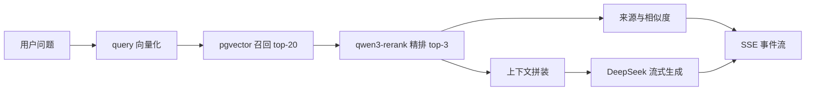

# 企业知识库 RAG 问答系统

面向企业制度、产品手册、售后工单、招投标文件和合同等非结构化知识的 RAG 问答系统。覆盖多模态文档入库、向量召回、两阶段精排、流式生成、来源引用、缓存降级与人工审批。

[](https://www.python.org/)
[](https://fastapi.tiangolo.com/)
[](https://github.com/spring5-20/business-rag-demo)
[](https://github.com/pgvector/pgvector)
[](https://developer.mozilla.org/docs/Web/API/Server-sent_events)

## 项目背景

企业知识通常分散在 HR 制度、产品手册、售后工单、扫描合同和内部文档中。传统关键词搜索无法理解语义，直接使用大模型又存在幻觉、数据泄露和回答不可追溯的问题。

本项目将“文档入库、检索、精排、生成、引用、审批”串成一条可运行的后端链路，并把每次回答绑定到可回溯的知识来源。

## 核心能力

### 多模态文档入库

- 支持文本 PDF、TXT、Markdown、扫描版 PDF 与图片。
- 文本按 `chunk 800 / overlap 150` 进行中文语义切分。
- 扫描 PDF 使用 PyMuPDF 按 200 DPI 渲染，再由 `qwen-vl` 识别文字、表格与图片描述。
- 使用 `text-embedding-v4` 生成向量并写入 PostgreSQL + pgvector。

### 两阶段检索与流式生成



生成结果通过 SSE 逐 Token 下发；首帧同时返回相似度、重排分数和 OSS 签名 URL 构成的引用来源。

### 缓存、失效与降级

- 缓存键由最新文档入库时间、问题哈希和检索参数组成。
- 新文档入库后，旧缓存自动失效。
- Redis 缓存默认 TTL 为 1 小时；Redis 故障时自动降级为实时计算。
- OSS 故障时关闭签名 URL 来源，问答主链路继续工作。

### Agent 编排与人工审批

- 基于 LangGraph 实现条件路由、答案质量自检与问题改写重试。
- 最多重试 3 轮，避免低质量问题直接返回。
- 使用 `interrupt_before` 与 checkpoint 状态恢复实现 human-in-the-loop 人工审批。

## 主要接口

| 方法 | 路径 | 说明 |
| --- | --- | --- |
| GET | `/api/v1/health` | 健康检查 |
| POST | `/api/v1/rag/pdf` | 文本 PDF 入库 |
| POST | `/api/v1/rag/pdf-vision` | 扫描 PDF 视觉识别入库 |
| POST | `/api/v1/rag/image` | 图片多模态入库 |
| POST | `/api/v1/rag/ask` | 基础 RAG 流式问答 |
| POST | `/api/v1/rag/langgraph/ask` | LangGraph 自检与改写问答 |
| POST | `/api/v1/rag/approval/ask` | 带人工审批的问答 |
| POST | `/api/v1/rag/approval/resume` | 恢复审批流程 |
| GET | `/api/v1/rag/approval/ui` | 审批演示页面 |

## 技术栈

| 领域 | 技术 |
| --- | --- |
| 后端 | FastAPI、Pydantic v2、SQLAlchemy 2.0 Async、Alembic |
| 数据 | PostgreSQL、pgvector、Redis |
| RAG | LangChain、LangGraph、text-embedding-v4、qwen3-rerank |
| 多模态 | PyMuPDF、qwen-vl、阿里云 OSS |
| 模型 | DeepSeek 流式生成 |
| 流式接口 | SSE |
| 工程化 | Docker Compose、uv、Ruff、mypy、pytest |

## 快速开始

### 1. 安装依赖

```bash
uv sync --group dev
```

### 2. 配置环境

```bash
copy src/.env.example src/.env
```

需要配置 PostgreSQL、Redis、DeepSeek、DashScope 与阿里云 OSS。仓库只提供占位配置，真实密钥不会提交。

### 3. 启动服务

```bash
uv run python src/run.py
```

无外部服务时可预览接口：

```bash
uv run python src/run.py --skip-infra
```

默认地址：

- Swagger：`http://127.0.0.1:8889/docs`
- 健康检查：`http://127.0.0.1:8889/api/v1/health`

### 4. 测试

```bash
uv run pytest -q
uv run ruff check .
uv run mypy src
```

## 目录结构

```text
.
├── src/
│   ├── app/
│   │   ├── api/v1/       # 文本、扫描件、图片入库与问答接口
│   │   ├── core/         # 嵌入、精排、视觉、OSS、数据库与 LangGraph
│   │   └── static/       # 人工审批演示页
│   ├── migrations/       # Alembic 迁移
│   └── run.py
├── tests/
├── Dockerfile
└── docker-compose.yml
```

## 工程成果

- 跑通文本 PDF、扫描 PDF 与图片三类语料入库，以及基础问答、自纠错循环和人工审批三条问答链路。
- 以知识库版本驱动缓存失效，保证新文档入库后回答始终基于最新语料。
- Redis 与 OSS 故障时自动降级，问答主链路不中断。
- 沉淀 asyncpg + pgvector 编码冲突、同步 SDK 阻塞事件循环等工程问题的处理方案。

## 安全说明

- `.env`、缓存、虚拟环境、日志、输出文件和测试文档均已排除。
- 公开配置中不包含真实 API Key、数据库密码或 OSS 凭据。
- 建议在生产环境中结合权限系统、审计日志与密钥管理服务使用。

## 作者

杨磊 · [GitHub](https://github.com/spring5-20) · [个人主页](https://github.com/spring5-20)
